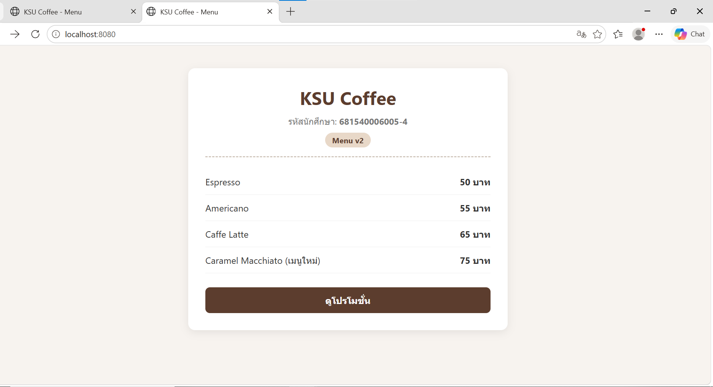
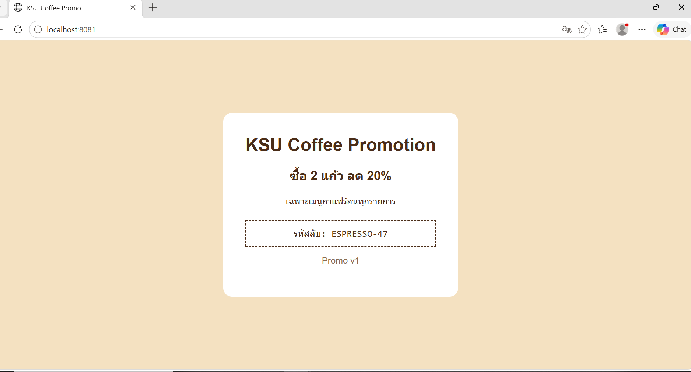

# ANSWER — <ชื่อ-นามสกุล> <รหัสนักศึกษา>

## Part A — ข้อมูลจาก image kamthornsa/ksu-promo:1.0

| คำถาม | คำตอบ | คำสั่งที่ใช้ |
| --- | --- | --- |
| Port | 3000 | `docker image inspect kamthornsa/ksu-promo:1.0 --format '{{json .Config.ExposedPorts}}'` |
| CMD | `["nginx", "-g", "daemon off;"]` | `docker image inspect kamthornsa/ksu-promo:1.0 --format '{{json .Config.Cmd}}'` |
| Base image | nginx:alpine | `docker image history kamthornsa/ksu-promo:1.0 --no-trunc` |

## Part B — รหัสลับบนหน้าโปรโมชั่น

ESPRESSO-47

## Part C — คำถาม

1. หน้าโปรโมชั่นถูกแพ็กเป็น Docker image สำเร็จรูปแล้ว ไฟล์อยู่ภายใน image ที่อ่านได้อย่างเดียว จึงแก้ไขไม่ได้ ส่วนหน้าเมนูสร้างจากซอร์สโค้ดในเครื่องของเรา จึงสามารถแก้ไขไฟล์ index.html แล้ว build image ใหม่ได้
2. หากไม่ระบุ tag ระบบจะดึง tag :latest ซึ่งอาจเปิดไม่ติดหรือแสดงหน้าเว็บคนละแบบ/เวอร์ชันที่ยังไม่สมบูรณ์ เพราะผู้สร้าง image อาจไม่ได้ตั้ง tag latest ไว้ หรือตั้งชี้ไปยัง commit อื่น
3. ตัวเลขซ้าย (8081) คือ Host Port ที่เปิดให้เบราว์เซอร์เข้าถึง ส่วนขวา (3000) คือ Container Port ที่แอปพลิเคชันภายในรันอยู่ สาเหตุที่ฝั่งขวาไม่ใช่ 80 เพราะ image นี้รันเว็บเซิร์ฟเวอร์บนพอร์ต 3000 ตามที่ระบุไว้ใน image inspect
4. จะไม่มีการเปลี่ยนแปลงใด ๆ บนหน้าเว็บ เพราะ Docker Compose จะใช้ cache ของ image เดิมที่สร้างไว้แล้ว คำสั่งที่ถูกต้องคือ `docker compose up -d --build` เพื่อบังคับให้สร้าง image ใหม่อีกครั้ง
5. ใช้ URL `http://localhost:8081` เพราะลิงก์ถูกคลิกและส่งคำขอจากเว็บเบราว์เซอร์บนเครื่อง Host ไม่ได้ส่งจากภายใน Docker network จึงไม่สามารถใช้ชื่อ service `http://promo:3000` ซึ่งรู้จักเฉพาะระหว่าง container ได้

## ภาพหน้าจอ

